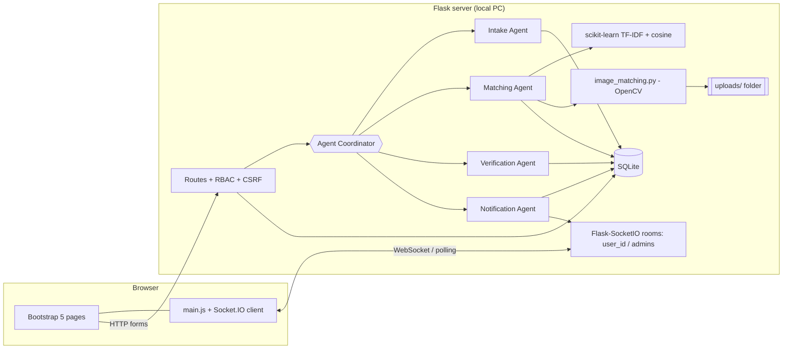
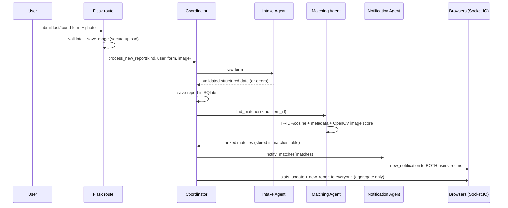
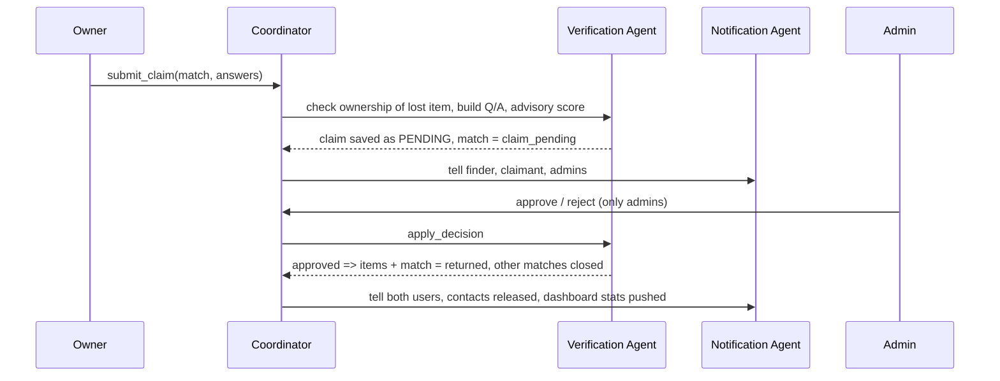
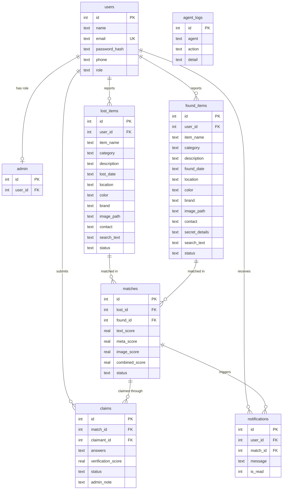

# Architecture, Workflow and ER Diagrams

Diagrams use Mermaid. They render in VS Code (extension "Markdown Preview Mermaid Support"), GitHub, or https://mermaid.live.

## 1. System architecture

## 2. Agent workflow: new report

## 3. Agent workflow: claim and return

## 4. Database ER diagram

## 5. How agents communicate

Agents are Python modules with plain functions. They never import or call each other. The coordinator is the only
component that knows the order of work:

| Step | Coordinator calls | Data in | Data out |
|---|---|---|---|
| 1 | `intake_agent.process` | raw form dict | `{ok, errors, data}` |
| 2 | `database_models.insert_item` | `data` | `item_id` |
| 3 | `matching_agent.find_matches` | kind, `item_id` | list of stored matches with scores |
| 4 | `notification_agent.notify_matches` | matches | notification rows + live events |
| 5 | `notification_agent.broadcast_*` | item / stats | live dashboard update |
| claim | `verification_agent.submit_claim` | match id, answers | pending claim + advisory score |
| decision | `verification_agent.apply_decision` | claim id, admin choice | items returned or match reopened |

Each step writes a row to `agent_logs`, so the hand-overs can be demonstrated live in **Admin > Overview**.
One deliberate change from the original list order: the Intake Agent validates **before** the report is saved,
so invalid data never reaches the database.
